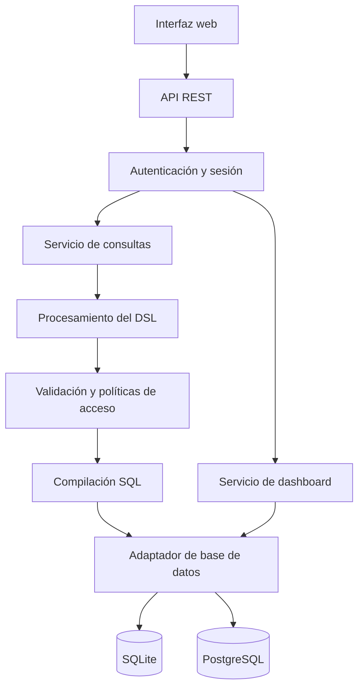
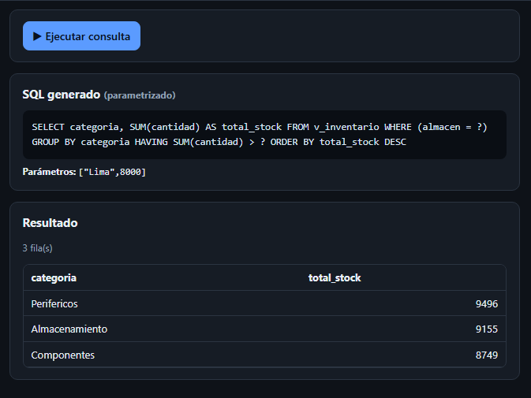
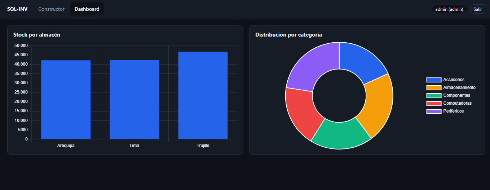

# SQL-INV — Motor de consultas SQL para gestión de inventario

SQL-INV es una aplicación web que permite construir y ejecutar consultas de inventario mediante un lenguaje específico de dominio (DSL) basado en SQL. A través de una interfaz visual, el usuario puede seleccionar campos, establecer condiciones, realizar agrupaciones y generar estadísticas sin escribir directamente sentencias SQL.

El sistema se desarrolla sobre el escenario de una empresa distribuidora de productos tecnológicos que administra inventarios y movimientos de existencias en tres almacenes ubicados en Lima, Arequipa y Trujillo.

## Funcionalidades principales

- Construcción visual de consultas de inventario y movimientos.
- Operaciones SELECT, WHERE, GROUP BY, HAVING y ORDER BY.
- Condiciones lógicas AND/OR anidadas.
- Funciones de agregación SUM, COUNT, AVG, MIN y MAX.
- Validación y generación de consultas SQL parametrizadas.
- Autenticación y restricciones de acceso por rol.
- Dashboard con estadísticas de inventario.
- Portabilidad de consultas entre SQLite y PostgreSQL.

## Tecnologías utilizadas

| Componente | Tecnologías |
| --- | --- |
| Backend | Node.js 24 LTS, Express |
| Frontend | HTML, CSS, JavaScript |
| Base de datos | SQLite, PostgreSQL |
| Acceso a datos | better-sqlite3, node-postgres |
| Visualización | Chart.js |
| Autenticación | Express Session, scrypt |
| Pruebas | Vitest, Supertest, jsdom |
| Contenedores | Docker |
| Integración continua | GitHub Actions |

## Arquitectura

El sistema separa la construcción y validación de consultas, las políticas de acceso, los servicios y la comunicación con los motores de datos.



SQLite es el motor principal del aplicativo. PostgreSQL se utiliza como motor alternativo para comprobar la portabilidad mediante un contrato común de adaptadores.

## Estructura del proyecto

```text
Trabajo-DSL/
├── .github/workflows/
├── docs/
├── examples/
├── src/
│   ├── adapters/
│   ├── config/
│   ├── db/
│   ├── dsl/
│   ├── public/
│   ├── routes/
│   ├── security/
│   ├── services/
│   ├── app.js
│   └── server.js
├── tests/
├── .dockerignore
├── .env.example
├── .gitignore
├── Dockerfile
├── package.json
├── package-lock.json
└── README.md
```

## Vista previa del aplicativo

### Constructor de consultas

Permite configurar consultas mediante una interfaz visual y obtener tanto la sentencia SQL generada como los resultados de su ejecución.



### Dashboard de inventario

Presenta estadísticas del stock por almacén y categoría, considerando los permisos del usuario autenticado.



## Instalación y ejecución local

### Requisitos

- Node.js 24 LTS.
- npm.
- Git.
- Docker (opcional).

### 1. Clonar el repositorio

```sh
git clone https://github.com/gonza-sw/Trabajo-DSL.git
cd Trabajo-DSL
```

### 2. Instalar las dependencias

```sh
npm ci
```

### 3. Configurar las variables de entorno

```sh
cp .env.example .env
```

Generar un secreto de sesión:

```sh
node -e "console.log(require('node:crypto').randomBytes(48).toString('hex'))"
```

Copiar el valor generado en la variable `SESSION_SECRET` del archivo `.env`.

| Variable | Descripción |
| --- | --- |
| PORT | Puerto del servidor (3000 por defecto) |
| DB_PATH | Ruta de la base de datos SQLite |
| SESSION_SECRET | Secreto de sesión de al menos 32 caracteres |
| POSTGRES_URL | Conexión opcional a PostgreSQL |

El archivo `.env` contiene configuración local y no debe publicarse en el repositorio.

### 4. Inicializar la base de datos

```sh
npm run seed
```

Este comando genera un dataset reproducible de 5311 registros distribuidos en seis tablas relacionadas y habilita las dos vistas utilizadas por el DSL.

La ejecución de la semilla reinicializa los datos existentes y está destinada a entornos de prueba y demostración.

### 5. Iniciar el aplicativo

```sh
npm start
```

Acceder desde el navegador a:

http://localhost:3000

## Cuentas de demostración

| Usuario | Contraseña | Alcance |
| --- | --- | --- |
| admin | AdminDemo2026! | Inventario y movimientos de todos los almacenes |
| operario | OperarioDemo2026! | Inventario y movimientos del almacén de Lima |
| consulta | ConsultaDemo2026! | Inventario del almacén de Arequipa |

Estas credenciales pertenecen exclusivamente al dataset de demostración y no deben utilizarse en entornos de producción.

## API REST

| Método | Endpoint | Descripción |
| --- | --- | --- |
| POST | `/api/auth/login` | Iniciar sesión |
| POST | `/api/auth/logout` | Cerrar sesión |
| GET | `/api/auth/me` | Obtener el usuario autenticado |
| GET | `/api/schema` | Obtener fuentes y campos disponibles |
| POST | `/api/query` | Validar y ejecutar consultas |
| GET | `/api/dashboard` | Obtener estadísticas de inventario |

## Pruebas automatizadas

Ejecutar la suite general de pruebas:

```sh
npm test
```

Ejecutar las pruebas por componente:

```sh
npm run test:dsl
npm run test:db
npm run test:frontend
npm run test:api
```

Generar el reporte de cobertura:

```sh
npm run test:coverage
```

Las pruebas de PostgreSQL requieren configurar `POSTGRES_URL` e inicializar previamente los datos en ambos motores. Las instrucciones correspondientes se encuentran en la [documentación de portabilidad](docs/07-portabilidad.md).

### Resultados de la validación final

| Indicador | Resultado |
| --- | ---: |
| Archivos de pruebas aprobados | 18 |
| Pruebas aprobadas | 202 |
| Pruebas fallidas | 0 |
| Pruebas omitidas | 0 |
| Cobertura de líneas | 91.75 % |

Los resultados corresponden a la ejecución con SQLite y PostgreSQL disponibles y a los archivos incluidos en el reporte de cobertura.

El repositorio utiliza GitHub Actions para automatizar la ejecución de pruebas durante la integración de cambios.

Las evidencias y los resultados detallados se encuentran en la [validación final del proyecto](docs/08-validacion-final.md).

## Ejecución mediante Docker

Construir la imagen del aplicativo:

```sh
docker build -t sql-inv .
```

Ejecutar el contenedor:

```sh
docker run --rm --name sql-inv-demo \
  -p 127.0.0.1:3000:3000 \
  -e NODE_ENV=development \
  -e SESSION_SECRET="$(node -e 'console.log(require("node:crypto").randomBytes(48).toString("hex"))')" \
  sql-inv
```

Acceder a:

http://localhost:3000

La imagen incorpora su propia base de datos SQLite, generada durante la construcción, y ejecuta el aplicativo mediante un usuario sin privilegios administrativos.

Esta configuración está destinada a demostraciones locales. Un despliegue en producción requiere HTTPS, cookies seguras, configuración adecuada del proxy y almacenamiento persistente de sesiones.

## Documentación del proyecto

- [00 — Contratos técnicos](docs/00-contratos-tecnicos.md)
- [01 — Bases teóricas](docs/01-bases-teoricas.md)
- [02 — Justificación del DSL](docs/02-justificacion-dsl.md)
- [03 — Demostración de abstracción](docs/03-demostracion-abstraccion.md)
- [04 — Metamodelo](docs/04-metamodelo.md)
- [05 — Requisitos del sistema](docs/05-requisitos.md)
- [06 — Demostración funcional del sistema](docs/06-demostracion.md)
- [07 — Portabilidad del motor de datos](docs/07-portabilidad.md)
- [08 — Validación final del proyecto](docs/08-validacion-final.md)