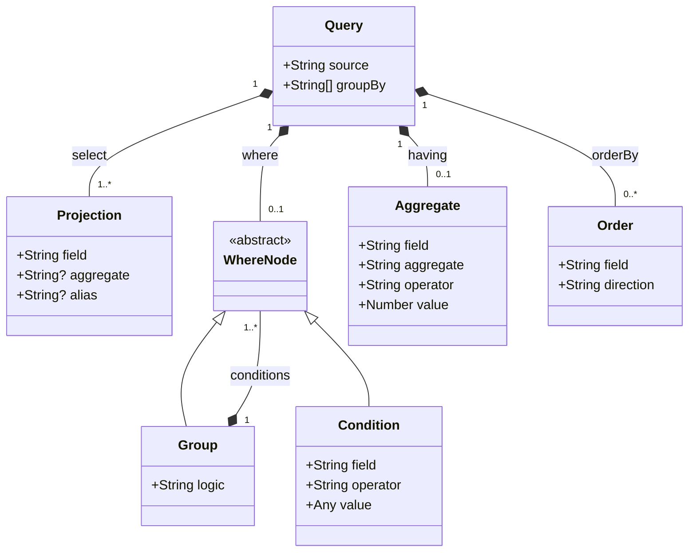

# 04 — Metamodelo del AST y Mapeo a SQL

## 1. Diagrama UML del Metamodelo

## 2. Mapeo del AST a sintaxis SQL

| Elemento del AST | Representación SQL |
| --- | --- |
| `Query.source` | `FROM <vista>` |
| `Projection` | `SELECT <campo>` o `<AGREGADO>(<campo>) AS <alias>` |
| `Group` | Grupo de condiciones entre paréntesis, unido por `AND` u `OR` |
| `Condition` | `<campo> <operador> ?` |
| `Query.groupBy` | `GROUP BY <campo>` |
| `Aggregate` (`having`) | `HAVING <AGREGADO>(<campo>) <operador> ?` |
| `Order` | `ORDER BY <campo o alias> ASC/DESC` |

Los valores de `Condition` y `Aggregate` se envían en `params`, en el mismo orden
en que aparecen los marcadores `?` en `sql`; no se interpolan en la cadena SQL.
