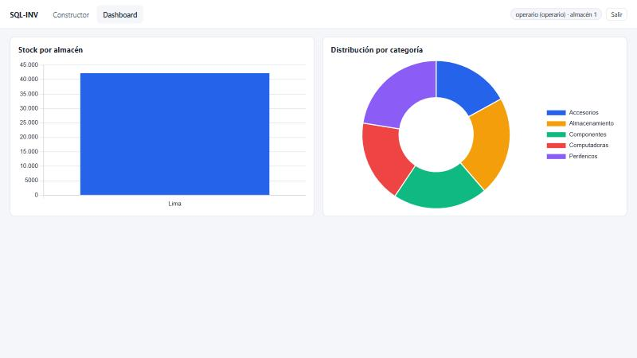

# Requisitos

Documento del Integrante 3 (interfaz visual y dashboard). Contexto: una distribuidora de productos tecnológicos con almacenes en Lima, Arequipa y Trujillo necesita consultar existencias y movimientos sin pedir un reporte nuevo por cada pregunta. La interfaz permite armar la consulta con selecciones; el servidor la valida, la compila a SQL parametrizado y devuelve el resultado.

## 1. Caso de uso principal

### UC-001: Construir y ejecutar una consulta de inventario

| Campo | Descripción |
|---|---|
| **ID** | UC-001 |
| **Actor principal** | Usuario autenticado (admin, operario o consulta) |
| **Actores secundarios** | API del sistema (validación, política de rol, ejecución) |
| **Precondiciones** | 1) El usuario inició sesión con una cuenta predefinida. 2) La API responde `/api/schema` con las fuentes que su rol puede usar. |
| **Postcondiciones** | 1) La pantalla muestra el SQL parametrizado, los parámetros y la tabla devuelta por la API. 2) Si la consulta fue rechazada, se muestra el código y el mensaje de error y no se muestran datos. 3) La interfaz nunca envía SQL ni la identidad del usuario: solo el JSON del contrato. |

**Flujo principal**
1. El usuario elige la fuente de datos (`v_inventario` o `v_movimientos`, según su rol).
2. Marca los campos a mostrar y, si lo desea, agrega agregaciones (SUM, COUNT, AVG, MIN, MAX) con alias.
3. Define filtros con grupos AND/OR anidados hasta 2 niveles.
4. Define GROUP BY (automático o manual), una condición HAVING y el ORDER BY sobre campos proyectados o alias.
5. La interfaz muestra el JSON exacto que se enviará y valida lo que puede validar en el cliente.
6. El usuario presiona "Ejecutar consulta".
7. La interfaz envía `POST /api/query`, muestra "Ejecutando…" y luego el SQL, los parámetros y la tabla de resultados.

**Flujos alternos**
- **5.a** La consulta tiene problemas visibles (sin campos, filtro sin valor, alias inválido, GROUP BY incoherente): se listan los problemas y no se llama a la API.
- **7.a** La API responde 400/403: se muestra `[CODIGO] mensaje` en el panel de resultados.
- **7.b** La API responde 401: la interfaz redirige a `login.html`.
- **7.c** La consulta no devuelve filas: se conservan los encabezados y se muestra "La consulta no devolvió filas".

## 2. Historias de usuario (Given / When / Then)

### HU-01: Armar una consulta avanzada
**Como** analista de inventario **quiero** combinar filtros anidados, una agregación, HAVING y orden desde la pantalla **para** conocer el stock por categoría sin pedir un reporte nuevo.

```gherkin
Scenario: Consulta avanzada con dos niveles de subgrupos
  Given que inicié sesión como admin y elegí la fuente "v_inventario"
  And marqué el campo "categoria" y agregué SUM sobre "cantidad" con alias "total_stock"
  When agrego el filtro precio < 500 y un subgrupo OR con almacen = "Lima"
    y otro subgrupo AND con almacen = "Arequipa" y cantidad > 0
  And agrego HAVING SUM(cantidad) > 100 y ordeno por "total_stock" de mayor a menor
  And presiono "Ejecutar consulta"
  Then la interfaz envía el JSON del contrato con GROUP BY ["categoria"]
  And muestra el SQL parametrizado, la lista de parámetros y la tabla devuelta por la API
```
Criterios de aceptación: A01 y A02 (consulta simple y avanzada). Pruebas: `builder-query.test.js` ("reproduce exactamente el ejemplo del contrato…"), `results.test.js`, `integration-ui.test.js`.

### HU-02: Rechazar una consulta inválida o no autorizada
**Como** responsable de seguridad **quiero** que la interfaz no permita enviar consultas incompletas y que muestre con claridad los rechazos del servidor **para** evitar consultas ambiguas o acceso a datos no autorizados.

```gherkin
Scenario: Consulta incompleta
  Given que estoy en el constructor sin ningún campo seleccionado
  When presiono "Ejecutar consulta"
  Then se muestra "Seleccione al menos un campo"
  And no se llama a la API

Scenario: Fuente o campo no autorizado
  Given que la API rechaza la consulta con 403 FORBIDDEN
  When presiono "Ejecutar consulta"
  Then el panel de resultados muestra "[FORBIDDEN] No tienes permiso para consultar esta fuente"
  And no se muestra ninguna tabla

Scenario: Valor con intento de inyección
  Given que escribo  ' OR 1=1 --  como valor de un filtro de texto
  When presiono "Ejecutar consulta"
  Then el valor viaja como dato en el JSON y nunca como parte de un SQL armado en el navegador
```
Criterio de aceptación: A03. Pruebas: `results.test.js` ("no llama a la API si la consulta no es válida…", "una consulta con filtro de texto envía el valor como dato…"), `integration-ui.test.js` (403).

### HU-03: Ver solo lo que mi rol permite, también en el dashboard
**Como** operario o usuario de consulta **quiero** que el catálogo y los gráficos reflejen solo mi alcance **para** no ver datos de otros almacenes ni fuentes restringidas.

```gherkin
Scenario: Catálogo restringido
  Given que inicié sesión con el rol consulta
  When la interfaz carga /api/schema
  Then solo se ofrece la fuente "v_inventario"

Scenario: Dashboard según sesión
  Given que abrí la vista Dashboard con el rol admin y veo tres almacenes
  When cierro sesión e ingreso como operario
  And abro la vista Dashboard
  Then la interfaz vuelve a pedir /api/dashboard
  And los gráficos muestran únicamente los datos que devuelve la API para ese usuario

Scenario: Dashboard sin datos o con error
  Given que la API devuelve series vacías o un error 500
  When abro la vista Dashboard
  Then se muestra "Sin datos para mostrar" o el mensaje de error, sin gráficos antiguos
```
Criterio de aceptación: A04. Pruebas: `selection.test.js` ("el rol consulta solo ve v_inventario"), `dashboard.test.js` ("cambio de sesión…", "series vacías…", "error de la API…").

## 3. Reglas de la interfaz

- La identidad (usuario, rol, almacén) viene siempre de la sesión del servidor; el JSON de consulta no la incluye.
- El cliente nunca arma ni envía SQL; solo el JSON del contrato (`source`, `select`, `where`, `groupBy`, `having`, `orderBy`).
- Profundidad máxima del filtro: raíz + 2 niveles de subgrupos.
- SUM y AVG solo se ofrecen sobre campos numéricos; LIKE solo sobre texto.
- Todo texto que viene del servidor (nombres de campos, valores, errores, SQL) se inserta con `textContent`, nunca con `innerHTML`.
- No hay datos simulados en el modo normal: los dobles de red viven solo en `tests/`.

## 4. Evidencias de ejecución

### 4.1 Pruebas automáticas

Comando: `npm run test:frontend` (Vitest + jsdom).

```
 api.test.js              14 pruebas
 builder-query.test.js    23 pruebas
 dashboard.test.js        10 pruebas
 selection.test.js        14 pruebas
 integration-ui.test.js    7 pruebas
 results.test.js          13 pruebas
 Test Files  6 passed (6)
      Tests  81 passed (81)
```

Suite completa del proyecto (`npm test`, con los módulos de los cuatro integrantes): 165 pruebas aprobadas y 13 omitidas (las de PostgreSQL, que requieren `POSTGRES_URL`).

| Área | Casos verificados |
|---|---|
| Selección | La fuente inicial es la primera del catálogo; cambiar de fuente conserva campos de igual nombre y tipo y limpia el resto; el rol consulta solo ve `v_inventario`; nombres de campo con HTML se muestran como texto. |
| Constructor | JSON simple; reproducción exacta del ejemplo del contrato; números como número y texto como string; grupos vacíos descartados; profundidad 3 rechazada; SUM/AVG solo numéricos; GROUP BY automático y manual; HAVING (propone la agregación proyectada); ORDER BY solo sobre campos proyectados; alias inválidos o reservados. |
| Resultados | Tabla con datos, sin filas, carga, error HTTP; datos con HTML como texto; descarte de respuestas obsoletas; botón deshabilitado durante la carga. |
| Dashboard | Series correctas a partir de `[{label,value}]`; barras y dona; colores según el tema; cambio de sesión destruye y recrea los gráficos; estados vacío y de error; sin datos inventados. |
| Interfaz completa | HTML real + cliente real con red simulada: sesión → esquema → consulta → dashboard; 401 redirige a login; salir; 403 y 500; `?mock=1` no activa nada. |

### 4.2 Verificación con la API y la base de datos reales

Entorno: `npm run seed` (5311 registros) y `npm start` en local, con las tres cuentas de demostración.

| Cuenta | Comprobación en la interfaz | Resultado observado |
|---|---|---|
| admin | Consulta avanzada (2 niveles, HAVING, ORDER BY) | 5 filas; parámetros `[500,"Lima","Arequipa",0,100]` |
| admin | Dashboard | 3 almacenes (Arequipa, Lima, Trujillo) y 5 categorías |
| operario | Consulta de `almacen`, `almacen_id` | 200 filas; `WHERE (almacen_id = ?)` con `[1]` |
| operario | Dashboard | Solo Lima |
| consulta | Fuentes ofrecidas | Solo `v_inventario` |
| consulta | Filtro con 2 niveles de subgrupos | 20 filas; filtro de almacén fuera del OR del usuario (`almacen_id = ?` con `2`) |
| consulta | Dashboard | Solo Arequipa |
| las tres | Cerrar sesión e ingresar con otra | El dashboard se vuelve a pedir y refleja el nuevo alcance |

Con esto se cubren los criterios A01, A02 y A04 desde la interfaz. A03 (consulta inválida) se verifica en las pruebas automáticas de la interfaz.

### 4.3 Capturas (datos reales)

**Constructor: consulta avanzada con su SQL parametrizado y resultado (admin)**


**Dashboard del rol admin**


**Dashboard del rol operario (solo Lima)**


