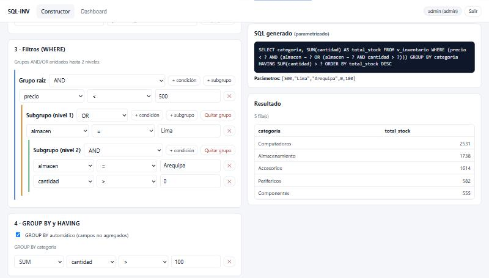
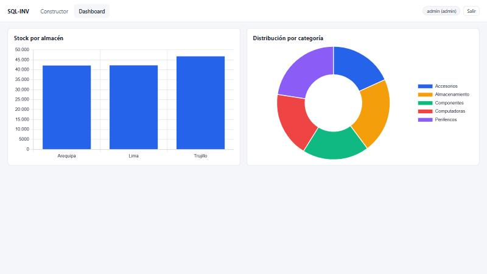

# 05 — Requisitos del sistema

SQL-INV permite consultar las existencias y los movimientos de inventario de una empresa distribuidora de productos tecnológicos con almacenes en Lima, Arequipa y Trujillo.

La interfaz visual permite construir consultas mediante la selección de campos, condiciones, agrupaciones y criterios de ordenamiento. El servidor valida estas consultas, aplica las políticas de acceso correspondientes, genera el SQL parametrizado y devuelve los resultados.

## 1. Caso de uso principal

### UC-001: Construir y ejecutar una consulta de inventario

| Campo | Descripción |
| --- | --- |
| **ID** | UC-001 |
| **Actor principal** | Usuario autenticado (admin, operario o consulta) |
| **Componentes involucrados** | Interfaz visual, API, DSL, políticas de acceso y servicios de consultas |
| **Precondiciones** | 1) El usuario inició sesión con una cuenta predefinida. 2) La API proporciona mediante `/api/schema` las fuentes de datos autorizadas para su rol. |
| **Postcondiciones** | 1) Si la consulta es válida, la pantalla muestra el SQL parametrizado, los parámetros y la tabla de resultados. 2) Si el servidor rechaza la consulta, se muestra el código y el mensaje de error sin conservar los resultados anteriores. 3) Si la consulta no supera la validación local, se informa al usuario, se limpian los resultados anteriores y no se envía la solicitud a la API. |

**Flujo principal**

1. El usuario selecciona una fuente de datos (`v_inventario` o `v_movimientos`), según su rol.
2. Selecciona los campos que desea visualizar y, opcionalmente, incorpora funciones de agregación (SUM, COUNT, AVG, MIN, MAX) y alias.
3. Define filtros mediante grupos AND/OR anidados hasta dos niveles de subgrupos.
4. Establece el GROUP BY, de forma automática o manual, una condición HAVING y el ORDER BY sobre campos proyectados o alias.
5. La interfaz presenta el JSON que se enviará a la API.
6. El usuario presiona "Ejecutar consulta" y la interfaz realiza las validaciones correspondientes.
7. La interfaz envía la solicitud mediante `POST /api/query` y muestra el estado de ejecución.
8. El servidor valida la consulta, aplica las políticas de acceso, genera el SQL parametrizado y ejecuta la consulta.
9. La interfaz presenta el SQL generado, los parámetros utilizados y la tabla de resultados.

**Flujos alternos**

- **6.a:** La consulta presenta problemas de configuración, como ausencia de campos seleccionados, filtros sin valor, alias inválidos o agrupaciones incoherentes. Se muestran los mensajes correspondientes, se limpian el SQL, los parámetros y los resultados anteriores, y no se envía la solicitud a la API.
- **8.a:** La API responde con un error 400 o 403. Se muestra el código y el mensaje de error en el panel de resultados, sin conservar los resultados anteriores.
- **8.b:** La API responde con un error 401. La interfaz redirige al usuario a `login.html`.
- **9.a:** La consulta no devuelve registros. Se conservan los encabezados de la tabla y se muestra el mensaje "La consulta no devolvió filas".

## 2. Historias de usuario (Given / When / Then)

### HU-01: Construir una consulta avanzada

**Como** analista de inventario, **quiero** combinar filtros anidados, funciones de agregación, HAVING y criterios de ordenamiento desde la interfaz, **para** conocer el stock por categoría sin solicitar un nuevo reporte.

```gherkin
Scenario: Consulta avanzada con dos niveles de subgrupos
  Given que inicié sesión como admin y elegí la fuente "v_inventario"
  And marqué el campo "categoria" y agregué SUM sobre "cantidad" con alias "total_stock"
  When agrego el filtro precio < 500 y un subgrupo OR con almacen = "Lima"
    y otro subgrupo AND con almacen = "Arequipa" y cantidad > 0
  And agrego HAVING SUM(cantidad) > 100 y ordeno por "total_stock" de mayor a menor
  And presiono "Ejecutar consulta"
  Then la interfaz envía el JSON del contrato con GROUP BY ["categoria"]
  And muestra el SQL parametrizado, la lista de parámetros y la tabla devuelta por la API
```

**Criterios de aceptación:** A01 y A02 (consulta simple y avanzada).

**Pruebas asociadas:** `builder-query.test.js`, `results.test.js` e `integration-ui.test.js`.

### HU-02: Rechazar consultas inválidas o no autorizadas

**Como** responsable de seguridad, **quiero** que la interfaz impida el envío de consultas incompletas y muestre claramente los rechazos del servidor, **para** evitar consultas ambiguas o accesos a datos no autorizados.

```gherkin
Scenario: Consulta incompleta
  Given que ejecuté una consulta válida y obtuve resultados
  When retiro todos los campos seleccionados
  And presiono "Ejecutar consulta"
  Then se muestra "Seleccione al menos un campo"
  And no se llama nuevamente a la API
  And se limpian el SQL, los parámetros y la tabla de resultados anteriores

Scenario: Recuperación después de una consulta incompleta
  Given que la interfaz rechazó una consulta sin campos seleccionados
  When selecciono nuevamente un campo válido
  And presiono "Ejecutar consulta"
  Then desaparece el mensaje de validación
  And se muestran el SQL, los parámetros y los resultados de la nueva consulta

Scenario: Fuente o campo no autorizado
  Given que la API rechaza la consulta con 403 FORBIDDEN
  When presiono "Ejecutar consulta"
  Then el panel de resultados muestra "[FORBIDDEN] No tienes permiso para consultar esta fuente"
  And no se muestra ninguna tabla

Scenario: Tratamiento de valores de entrada
  Given que introduzco un valor de texto con caracteres especiales en un filtro
  When presiono "Ejecutar consulta"
  Then el valor viaja como dato en el JSON
  And el servidor lo incorpora como parámetro de la consulta SQL
```

**Criterio de aceptación:** A03 (validación y seguridad de consultas).

**Pruebas asociadas:** `results.test.js`, `integration-ui.test.js` y `regresiones.test.js`.

### HU-03: Consultar información según el rol de acceso

**Como** operario o usuario de consulta, **quiero** que las fuentes de datos y los gráficos reflejen únicamente mi alcance autorizado, **para** consultar la información correspondiente a mi almacén.

```gherkin
Scenario: Catálogo restringido
  Given que inicié sesión con el rol consulta
  When la interfaz carga /api/schema
  Then solo se ofrece la fuente "v_inventario"

Scenario: Dashboard según sesión
  Given que abrí la vista Dashboard con el rol admin y veo tres almacenes
  When cierro sesión e ingreso como operario
  And abro la vista Dashboard
  Then la interfaz vuelve a pedir /api/dashboard
  And los gráficos muestran únicamente los datos que devuelve la API para ese usuario

Scenario: Dashboard sin datos o con error
  Given que la API devuelve series vacías o un error 500
  When abro la vista Dashboard
  Then se muestra "Sin datos para mostrar" o el mensaje de error, sin gráficos antiguos
```

**Criterio de aceptación:** A04 (restricciones de acceso y visualización de estadísticas).

**Pruebas asociadas:** `selection.test.js` y `dashboard.test.js`.

## 3. Reglas de la interfaz

- La identidad del usuario, su rol y el almacén asignado se obtienen de la sesión del servidor y no se incluyen en el JSON de consulta.
- El cliente no construye ni envía sentencias SQL directamente. Utiliza el contrato JSON compuesto por `source`, `select`, `where`, `groupBy`, `having` y `orderBy`.
- Los filtros admiten un grupo raíz y hasta dos niveles de subgrupos AND/OR.
- Las funciones SUM y AVG solo se admiten sobre campos numéricos.
- El operador LIKE se admite sobre campos de texto. Las comparaciones de orden (`>`, `>=`, `<`, `<=`) también se admiten sobre texto, permitiendo establecer rangos de fechas en formato ISO.
- Cuando se utilizan agregaciones o condiciones HAVING, las columnas no agregadas deben formar parte del GROUP BY.
- En las condiciones HAVING sobre campos de texto, la interfaz permite utilizar COUNT.
- El ORDER BY se actualiza al modificar el alias de una columna y se elimina cuando se retira la columna asociada.
- Cuando la API rechaza una consulta, se limpian el SQL, los parámetros y los resultados anteriores, y se muestra el mensaje de error correspondiente.
- Cuando una consulta no supera la validación local, se muestran los mensajes correspondientes, se restablece el panel de resultados y no se envía la solicitud al servidor.
- Las respuestas de ejecuciones anteriores se descartan cuando se inicia un nuevo intento de consulta, evitando que se presenten resultados obsoletos.
- Los textos y valores recibidos desde el servidor se presentan mediante `textContent`, evitando su interpretación como código HTML.
- La interfaz obtiene los datos de la API. Los datos simulados se utilizan exclusivamente en las pruebas automatizadas.

## 4. Validación de requisitos

### 4.1. Pruebas automatizadas de la interfaz

Las pruebas de la interfaz se ejecutan mediante Vitest y jsdom.

```sh
npm run test:frontend
```

| Archivo de pruebas | Pruebas aprobadas |
| --- | ---: |
| `api.test.js` | 14 |
| `builder-query.test.js` | 23 |
| `dashboard.test.js` | 10 |
| `selection.test.js` | 14 |
| `integration-ui.test.js` | 7 |
| `results.test.js` | 13 |
| `regresiones.test.js` | 12 |
| **Total** | **93** |

| Indicador | Resultado |
| --- | ---: |
| Archivos de pruebas aprobados | 7 |
| Pruebas aprobadas | 93 |
| Pruebas fallidas | 0 |
| Cobertura de líneas de la interfaz | 95.66 % |

Las pruebas comprenden las siguientes áreas:

| Área | Casos verificados |
| --- | --- |
| Selección de fuentes y campos | Carga del catálogo, conservación de campos compatibles al cambiar de fuente, restricciones por rol y presentación segura de nombres de campos. |
| Constructor de consultas | Generación del JSON, validación de tipos, filtros anidados, funciones de agregación, agrupaciones, HAVING, alias y criterios de ordenamiento. |
| Resultados | Presentación de tablas, resultados vacíos, estados de carga, errores HTTP y descarte de respuestas obsoletas. |
| Dashboard | Generación de gráficos, actualización según la sesión, adaptación al tema visual y tratamiento de estados vacíos o errores. |
| Integración de la interfaz | Autenticación, carga del esquema, ejecución de consultas, visualización del dashboard y cierre de sesión mediante solicitudes simuladas. |
| Regresión | Alias de columnas, actualización de ORDER BY, generación automática de GROUP BY, condiciones HAVING, filtros por fechas, limpieza de resultados ante errores de la API y consultas inválidas, y recuperación después de corregir una consulta incompleta. |

La suite completa del proyecto obtuvo 203 pruebas aprobadas, distribuidas en 18 archivos de pruebas, sin fallos ni omisiones, con SQLite y PostgreSQL disponibles.

Los resultados generales y las evidencias de cobertura se encuentran en la [validación final del proyecto](08-validacion-final.md).

### 4.2. Verificación con la API y la base de datos

La validación funcional se realizó utilizando el dataset de 5311 registros y las tres cuentas de demostración del sistema.

| Rol | Comprobación | Resultado observado |
| --- | --- | --- |
| admin | Consulta avanzada con filtros anidados, HAVING y ORDER BY | 5 filas; parámetros `[500,"Lima","Arequipa",0,100]`. |
| admin | Dashboard | Estadísticas de los tres almacenes y las cinco categorías. |
| operario | Consulta de `almacen` y `almacen_id` | 200 filas correspondientes a Lima; restricción `WHERE (almacen_id = ?)` con parámetro `[1]`. |
| operario | Dashboard | Estadísticas correspondientes únicamente a Lima. |
| consulta | Fuentes de datos disponibles | Solo se ofrece `v_inventario`. |
| consulta | Filtro con dos niveles de subgrupos | 20 filas; la restricción del almacén de Arequipa se aplica fuera del grupo OR definido por el usuario. |
| consulta | Dashboard | Estadísticas correspondientes únicamente a Arequipa. |
| Todos | Cierre de sesión e ingreso con otra cuenta | El dashboard vuelve a solicitar los datos y refleja el nuevo alcance autorizado. |

Las comprobaciones permiten verificar los criterios de aceptación A01, A02 y A04 desde la interfaz. El criterio A03 se verifica mediante las pruebas automatizadas y las validaciones de consultas incompletas.

### 4.3. Comprobaciones funcionales adicionales

| Caso | Resultado observado |
| --- | --- |
| Consulta de movimientos por rango de fechas | 24 filas correspondientes al 1 de junio de 2026, coincidentes con la consulta directa a la base de datos. |
| HAVING sin agregación en SELECT | Generación automática de `GROUP BY categoria HAVING SUM(cantidad) > ?` y obtención de 5 filas. |
| Modificación del alias de una columna | Actualización automática del alias utilizado en ORDER BY. |
| Eliminación de una columna utilizada en ORDER BY | Eliminación automática de la condición de ordenamiento asociada. |
| Consulta sin resultados | Se muestra "La consulta no devolvió filas". |
| Consulta sin campos seleccionados | Se muestra "Seleccione al menos un campo", se limpian el SQL, los parámetros y la tabla de resultados anteriores, y no se llama a la API. |
| Recuperación después de una consulta inválida | Al seleccionar nuevamente un campo válido y ejecutar la consulta, desaparece el mensaje de validación y se presentan los nuevos resultados. |
| Dashboard del administrador | Arequipa: 42131, Lima: 42217 y Trujillo: 46745 unidades, coincidentes con los datos almacenados. |
| Operario consulta otros almacenes mediante OR | No se obtienen registros de almacenes no autorizados. |
| Usuario consulta | Acceso exclusivo a `v_inventario` y estadísticas de Arequipa. |
| Cierre de sesión | Redirección a `login.html`. |

### 4.4. Evidencias de ejecución

**Constructor de consultas**

Construcción y ejecución de una consulta avanzada, mostrando el SQL parametrizado y los resultados obtenidos.



**Validación de consultas incompletas**

La interfaz impide la ejecución de consultas sin campos seleccionados, muestra el mensaje de validación y restablece el panel de resultados, evitando que se presente información correspondiente a una consulta anterior.


**Dashboard del administrador**

Visualización de estadísticas correspondientes a todos los almacenes.



**Dashboard del operario**

Visualización de estadísticas restringidas al almacén de Lima.


Las evidencias adicionales de consultas, restricciones de acceso, cobertura, portabilidad y ejecución mediante Docker se encuentran en la [validación final del proyecto](08-validacion-final.md).