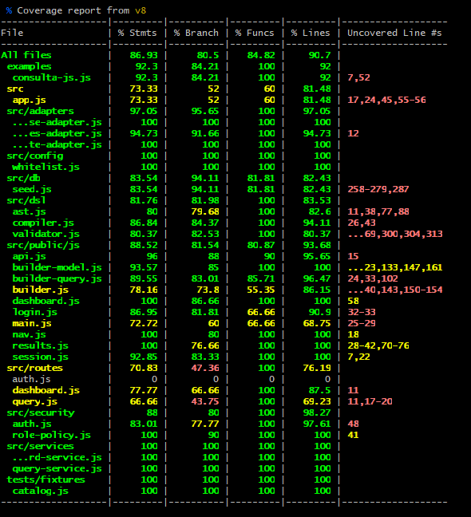
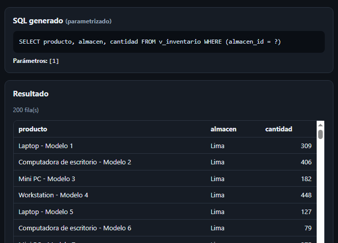
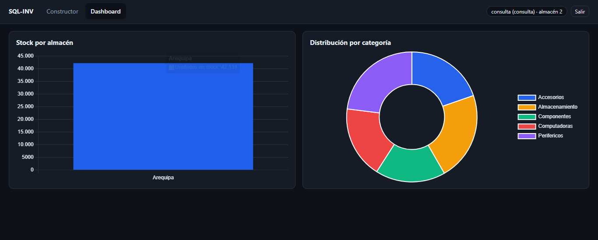
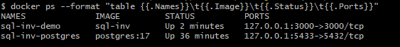

# 08 — Validación final del proyecto

## 1. Objetivo

Verificar el funcionamiento integrado de SQL-INV, considerando la construcción de consultas mediante el DSL, la integridad de los datos, las políticas de acceso, la visualización de estadísticas, la portabilidad del motor de datos y la ejecución del aplicativo mediante Docker.

## 2. Validación del dataset

La inicialización de la base de datos permite generar un conjunto de datos reproducible para las pruebas y demostraciones del sistema.

| Tabla | Registros |
| --- | ---: |
| categorias | 5 |
| productos | 200 |
| almacenes | 3 |
| inventario | 600 |
| movimientos | 4500 |
| usuarios | 3 |
| **Total** | **5311** |

El dataset fue generado tanto en SQLite como en PostgreSQL, conservando la estructura relacional y los datos de inventario necesarios para comprobar la equivalencia de las consultas entre ambos motores.

Las pruebas verifican la integridad referencial, las restricciones del esquema, la ausencia de cantidades negativas y la correspondencia entre las existencias y los movimientos registrados.

## 3. Pruebas automatizadas

### 3.1. Resultados generales

La suite completa de pruebas fue ejecutada con ambos motores de datos disponibles.

```sh
npm test
```

| Componente | Pruebas aprobadas |
| --- | ---: |
| DSL | 25 |
| Base de datos, adaptadores y servicios | 60 |
| Interfaz de usuario | 81 |
| API y políticas de acceso | 11 |
| Integración | 14 |
| **Total** | **191** |

| Indicador | Resultado |
| --- | ---: |
| Archivos de pruebas aprobados | 17 |
| Pruebas aprobadas | 191 |
| Pruebas fallidas | 0 |
| Pruebas omitidas | 0 |


Las pruebas comprenden tanto el comportamiento individual de los componentes como su integración, desde la construcción de la consulta hasta la obtención de resultados desde la base de datos.

### 3.2. Cobertura de código

La cobertura se obtuvo mediante el siguiente comando:

```sh
npm run test:coverage
```

| Indicador | Cobertura |
| --- | ---: |
| Sentencias | 86.93 % |
| Ramas | 80.50 % |
| Funciones | 84.82 % |
| Líneas | 90.70 % |

La cobertura de líneas por componente fue la siguiente:

| Componente | Cobertura de líneas |
| --- | ---: |
| Adaptadores | 97.05 % |
| Base de datos | 82.43 % |
| DSL | 83.53 % |
| Interfaz de usuario | 93.68 % |
| Rutas de la API | 76.19 % |
| Seguridad | 98.27 % |
| Servicios | 100.00 % |



Los porcentajes corresponden a los archivos incluidos en el reporte de cobertura. Aunque los resultados superan el 60 % en los componentes indicados, todavía existen rutas y condiciones particulares que pueden incorporar pruebas adicionales.

## 4. Validación funcional

### 4.1. Construcción de consultas avanzadas

Se verificó la construcción de una consulta que combina proyección, filtrado, agregación, agrupación, HAVING y ordenamiento desde la interfaz gráfica.

La consulta obtiene las categorías del almacén de Lima cuyo stock total supera las 8000 unidades.

```sql
SELECT categoria, SUM(cantidad) AS total_stock
FROM v_inventario
WHERE (almacen = ?)
GROUP BY categoria
HAVING SUM(cantidad) > ?
ORDER BY total_stock DESC
```

Parámetros utilizados:

```json
["Lima", 8000]
```

| Categoría | Stock total |
| --- | ---: |
| Perifericos | 9496 |
| Almacenamiento | 9155 |
| Componentes | 8749 |


El resultado demuestra que las operaciones seleccionadas desde la interfaz se traducen en una sentencia SQL parametrizada y que los datos obtenidos se presentan correctamente en la tabla de resultados.

### 4.2. Políticas de acceso por rol

Se verificó que una consulta de inventario sin filtros devuelve resultados diferentes según el usuario autenticado.

| Rol | Registros obtenidos | Almacenes autorizados |
| --- | ---: | --- |
| Administrador | 600 | Lima, Arequipa y Trujillo |
| Operario | 200 | Lima |
| Consulta | 200 | Arequipa |

#### Rol operario

El servidor incorpora automáticamente una condición sobre el identificador del almacén de Lima, limitando los resultados al ámbito autorizado.



#### Rol consulta

El servidor aplica la restricción correspondiente al almacén de Arequipa. Adicionalmente, las pruebas automatizadas verifican que este rol no puede consultar la vista de movimientos.


Las restricciones se aplican desde el servidor y no dependen exclusivamente de las opciones disponibles en la interfaz.

## 5. Validación del dashboard

El dashboard presenta dos gráficos de agregación: stock total por almacén y distribución del stock por categoría.

Se verificó que ambos gráficos respetan el alcance de acceso de cada usuario.

### 5.1. Dashboard del administrador

El administrador visualiza las estadísticas correspondientes a los tres almacenes.

| Almacén | Stock total |
| --- | ---: |
| Lima | 42217 |
| Arequipa | 42131 |
| Trujillo | 46745 |
| **Total** | **131093** |


### 5.2. Dashboard del operario

El operario visualiza únicamente las estadísticas del almacén de Lima, cuyo stock total es de 42217 unidades.


### 5.3. Dashboard del usuario consulta

El usuario consulta visualiza únicamente las estadísticas del almacén de Arequipa, cuyo stock total es de 42131 unidades.



La validación confirma que las políticas de acceso también se aplican a las consultas de agregación utilizadas para generar las estadísticas.

## 6. Validación de portabilidad

Se comprobó la ejecución de consultas equivalentes en SQLite y PostgreSQL mediante el contrato común de los adaptadores de base de datos.

Las pruebas verificaron consultas parametrizadas, agregaciones, resultados vacíos, restricciones de lectura y equivalencia de resultados entre ambos motores.

Asimismo, las pruebas de integración comprobaron que el servicio de consultas conserva su comportamiento y las políticas de acceso al utilizar cualquiera de los dos adaptadores.

Los procedimientos, resultados y evidencias específicas se encuentran en la [documentación de portabilidad del motor de datos](07-portabilidad.md).

## 7. Validación de ejecución mediante Docker

Se verificó la construcción de la imagen del aplicativo y su ejecución en un contenedor.

```sh
docker build -t sql-inv .
```

La imagen incorpora las dependencias necesarias y genera el dataset SQLite durante su construcción, permitiendo ejecutar el aplicativo sin configurar una base de datos externa.

Durante la ejecución del contenedor se comprobó el inicio de sesión, la ejecución de una consulta básica de inventario con 600 registros y la visualización del dashboard.



El procedimiento completo de ejecución se encuentra en el [README del proyecto](../README.md).

## 8. Conclusiones

Los resultados obtenidos permiten comprobar el funcionamiento integrado de SQL-INV y el cumplimiento de las principales funcionalidades definidas para el proyecto.

La ejecución satisfactoria de las 191 pruebas automatizadas, la cobertura de líneas del 90.70 % y las verificaciones funcionales respaldan el comportamiento de los componentes evaluados.

La generación de consultas parametrizadas, las restricciones por rol y la equivalencia de resultados entre SQLite y PostgreSQL demuestran las capacidades del DSL y la separación entre la lógica de consultas y el motor de almacenamiento.

Finalmente, la ejecución mediante Docker facilita la reproducción del entorno de demostración del aplicativo.